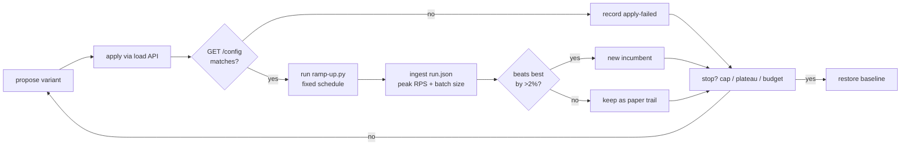

# Autonomous Triton Config Campaign

Port of the `karpathy/autoresearch` iterative-experiment loop onto Triton
dynamic-batching tuning. A deterministic Python driver mutates **one model
config per experiment**, applies it to the live server through the Triton load
API, runs `ramp-up.py` under a **fixed** load schedule, records every artifact
into a nested folder named by peak throughput, keeps or discards the result,
and repeats until it plateaus. Fully unattended.

## The loop



## Roles, mapped from autoresearch

| autoresearch | this repo |
|---|---|
| `prepare.py` — fixed, never modified | `experiment_config.py`, `ramp-up.py` |
| `train.py` — the one file that changes | the model config JSON sent to Triton |
| `program.md` — human-edited instructions | `program.md` |
| fixed 5-minute budget ⇒ comparable runs | fixed ramp schedule, identical every experiment |
| single metric `val_bpb` | single ratchet metric: peak aggregate RPS |
| keep-or-discard ratchet | same, in `campaign.py::judge` |
| `results.tsv` left untracked | `results.tsv` per campaign, committed alongside it |
| `analysis.ipynb` | `analyze.py` → `progress.png` |

## Quick start

```bash
# 1. one-time: restart Triton with the load API enabled (see below)
# 2. confirm the server is ready to be reconfigured
python campaign.py --dry-run          # no server changes, shows the search order

# 3. run a campaign
python campaign.py --max-experiments 6 --budget 900

# 4. read the results
python analyze.py
```

## Prerequisite: the server must allow runtime config changes

`campaign.py` changes configs in memory via
`POST /v2/repository/models/{name}/load`. That only works when Triton runs with
`--model-control-mode=explicit`. `triton-models/run_triton.sh` has been updated
to pass it, along with `--load-model='*'` (explicit mode otherwise loads
nothing at boot) and `-p 8002:8002` (Prometheus metrics). **Restart the server
before running a campaign.**

`campaign.py` checks this before spending any time and fails fast with the
server's own error text if the flag is missing.

## What varies and what never does

Variable (the search space, in `experiment_config.py`):

| knob | values |
|---|---|
| `max_batch_size` | 1, 8, 16, 32, 64, 128 |
| `preferred_batch_size` | auto (omit), tiny, small, mid, wide, current |
| `max_queue_delay_microseconds` | 0, 500, 2000, 5000, 10000, 25000 |
| `instance_group.count` | 1, 2, 3, 4 |

Fixed for the whole campaign, because a moving measurement invalidates every
comparison: ramp schedule, stage duration, warmup, payload, endpoint, server,
and the plateau/failure stop rules.

## Search strategy

1. **1-D sweep** — every single-knob value, each measured against the pristine
   baseline. Reveals each knob's individual effect. Non-improvements here never
   trigger the plateau stop; most knobs have a bad side.
2. **Coordinate descent** — from the best point found, re-sweep each knob with
   the others pinned, accepting only improvements. This catches interactions a
   1-D sweep cannot see, e.g. a large `max_batch_size` only paying off once the
   queue delay is long enough to fill it.

Variants are deduplicated by a hash of the scheduling-relevant fields, so
values equal to the baseline are not re-measured.

## Result layout

```
experiments/<campaign-YYYYMMDD-HHMMSS>/
    campaign.json          frozen schedule, space, limits, full baseline config
    results.tsv            one row per experiment (the index)
    progress.png           peak RPS with the best-so-far ratchet + batch size
    exp-01_1152rps/        folder name carries the measured peak throughput
        config.baseline.json   the pristine config, for reference
        config.sent.json       what we asked Triton to apply
        config.applied.json    what Triton reports after applying (proof)
        config.diff.json       the delta vs baseline
        ramp-results.csv       per-stage client + server metrics
        stats.deltas.json      raw Triton stats deltas per stage
        run.json               provenance envelope
        ramp-*.png             throughput / latency / errors / batch size
        stdout.log             the ramp subprocess log
```

Failed experiments get their own folder and a `status` field rather than being
dropped — the failures are the paper trail.

## Reading the results

`analyze.py` prints the improvement trail, per-knob marginals, and a
leaderboard. Two metrics matter:

- **peak RPS** is the ratchet, but
- **RPS at 8/16/32 connections** is the operational tiebreaker. A config that
  peaks at 100 connections is far less useful than one that peaks at 20.
- **realised avg batch size** (`inference_count / execution_count`, from
  Triton's own stats) is the mechanism. If a config wins but its batch size did
  not move, the win is noise, not batching.

## Safety rules

- The pristine baseline config is captured at preflight and **always restored**
  at the end, on Ctrl-C, and on crash.
- Configs are never hand-written: `GET /config` → deep copy → mutate one knob →
  `POST /load`. Sending a partial config would silently drop required fields.
- Every apply is verified with a follow-up `GET /config`; a mismatch marks the
  experiment invalid rather than measuring an unknown config.
- Only one model is ever unloaded, and only the model under test.
- A per-experiment subprocess timeout plus a consecutive-failure cap stop the
  campaign if the server wedges.

## Adding a dimension

1. Add the value list to `experiment_config.py`.
2. Handle it in `apply_variant`, `config_fingerprint`, `config_diff`, and
   `neighbour_variants`.
3. Nothing else — the sweep, descent, ratchet, folders, and report all follow.

## Known limits

- Closed-loop ramping cannot form batches larger than its own concurrency, so
  low-concurrency stages under-test batching. The campaign ramps to 60.
- Config overrides are in-memory only and vanish on server restart. That is a
  feature here: the server always returns to its on-disk truth.
- The README's priority test needs open-loop load (fixed offered RPS), which the
  closed-loop ramp cannot express. That is a separate campaign type.
