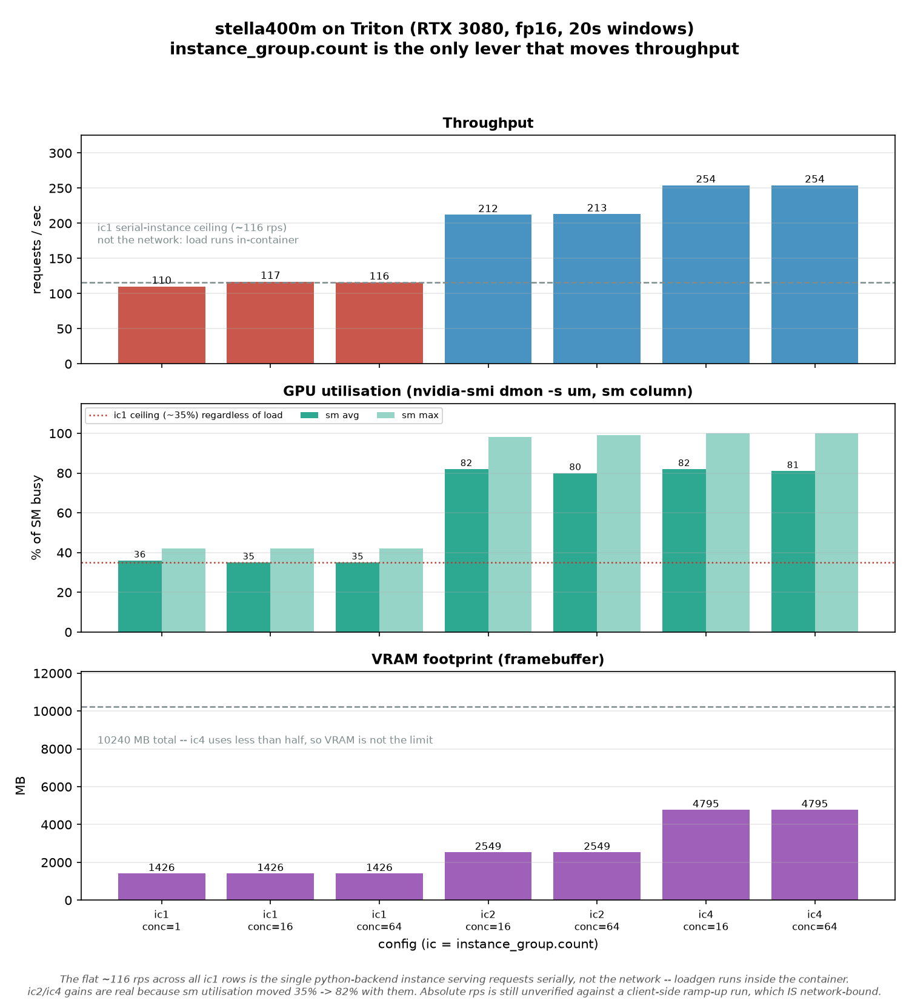
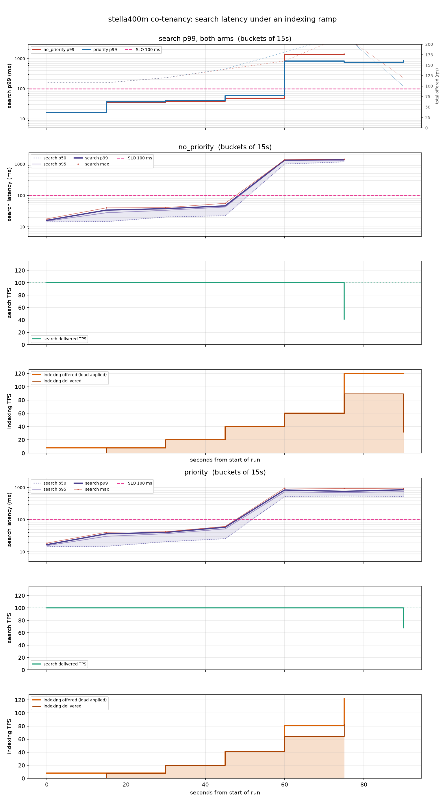

## How this was built
Built the plan with free copilot credit - luna 6 was chosen by 'auto' in plan mode, local.
Manually switched to Radiance qwen3.8 flash next to build the plan. 
Astonishingly fast. 1-7k prompt processing, 150-200 t/s Feels significantly faster than Luna.

## Purpose
I want a way to repeatably test the latency and throughput of a triton server with more than one model being served.  The goal is to iterate a bit on batch configurations with regard to size, wait duration, etc. and see what sort of throughput we can achieve on an RTX3080 which is a good stand in for Ampre GPU in EC2 level of performance.

I would like to get a non batched vs a batched configuration comparison in place to prove out the hypothesis thatr we are spending 10x what we need on GPU's at the moment.

## Running a benchmark

```bash
# one-shot ramp: 1 -> 100 connections, +5 per stage, 10s per stage
python ramp-up.py

# a shorter, single-model run written somewhere specific
python ramp-up.py --only onnx --max 60 --duration 8 --output-dir /tmp/quick
```

Every knob is a flag; `python ramp-up.py --help` lists them. Each run writes a
CSV, PNG graphs, `run.json` (provenance) and `stats.deltas.json` (Triton's own
server-side counters, including realised average batch size).

### Per-stage system telemetry

On by default. Every ramp stage samples **CPU per core**, **network throughput
against that interface's link speed**, and **server VRAM / GPU util** on both
machines, then prints a line under the stage and writes `system.json`:

```
Peak stage resources : client cpu 24% [1 pegged] | net 12.9 MB/s (98% of 100M,
                       SATURATED) ; server cpu 8% | net 12.5 MB/s (9% of 1000M)
                       | vram 814 MiB  <-- client: enx00e04c6803f3 at 98.1% of
                       a 100 Mbps link
```

That line is the whole point: it says *what* capped a stage, so a plateau can
be attributed to a resource instead of being read as a model result. The server
is sampled over ssh with one self-contained probe per stage (no dependencies on
the remote host). Network bytes are **wire** bytes — Triton gzips responses when
the client offers `Accept-Encoding`, so expect ~0.48x the JSON length.

```bash
python ramp-up.py --no-system                    # skip it
python ramp-up.py --server-ssh ""                # client only
python system_metrics.py --server-ssh 7700x      # sanity-check the plumbing
```

## Running a config-search campaign

`campaign.py` iterates model configurations autonomously — apply, verify,
benchmark, keep or discard — and stops on plateau, experiment cap, or time
budget. See `EXPERIMENT_CAMPAIGN_PLAN.md` for the design and `program.md` for
the protocol.

**One-time prerequisite:** restart Triton with
`triton-models/run_triton.sh`, which now passes `--model-control-mode=explicit`
so configs can be changed at runtime. Without it the campaign refuses to start.

```bash
python campaign.py --dry-run                        # show the search order only
python campaign.py --max-experiments 6 --budget 900 # a short real campaign
python analyze.py                                   # leaderboard + progress.png
```

Results land in `experiments/<campaign-timestamp>/exp-<NN>_<peakRps>rps/`.

## Stella 400M (single-model server)

`stella400m` is the 400M-parameter Stella encoder (`NovaSearch/stella_en_400M_v5`)
behind the Triton python backend: text in, unit-length 1024-d vector out. That is
the entire contract, and it matches production — the service returns embeddings.
No corpus, no cosine similarity, no retrieval anywhere in this model. It sits at
18x the size of `miniLM-512`, so unlike the smaller models the GPU actually has
work to do. Read the docstring in `triton-models/stella400m/1/model.py` before
touching the load path — it needs two transformers-5 shims and both fail
*silently* (the model returns unit-length vectors that are nearly identical for
every input).

```bash
# on the triton host: stella only, detached, polls until READY (~26s cold)
triton-models/run_triton_stella.sh --bg
triton-models/run_triton_stella.sh --stop

# from anywhere: freeform, passage-side (--passage skips the instruct prompt),
# or the regression gate
./test-stella.sh "reset my password"
./test-stella.sh --passage "Paris is the capital of France."
HOST=http://localhost:8000 ./test-stella.sh --check   # run this ON the host
```

`--check` computes similarity *in the test script*, not in the service, because
ranking is the only way to tell a good embedding from a broken one. The two ways
this model breaks (uninitialised rope buffers, the instruct prompt applied to
both sides) are invisible in the output shape. It asserts a similarity gap > 0.2
between a matching and an unrelated passage.

### What's in the repo

This repo is the source of truth for the deployment. Vendored under
`triton-models/stella400m/1/`: `model.py`, the checkpoint's `configuration.py`
and `modeling.py` (its `config.json` `auto_map` points at them), `config.json`,
`tokenizer.json`, `tokenizer_config.json`, `vocab.txt`, `1_Pooling/config.json`
and `2_Dense_1024/config.json`. All MIT-licensed upstream code, byte-identical
to the checkpoint.

The only thing not committed is the 1.7 GB `model.safetensors`:

```bash
# on the triton host — the one download a rebuild needs
huggingface-cli download NovaSearch/stella_en_400M_v5 \
  --local-dir /AI/models/triton/stella400m/1 \
  --include "*.safetensors"
```

`model.py` loads from its own directory, so the weights go beside the vendored
files. Do not "fix" `config.json` to drop `use_memory_efficient_attention` /
`unpad_inputs` — `model.py` already overrides both to `False`, because they need
xformers, which the borrowed miniLM env does not have.

The sweep is deliberately separate from `campaign.py` — it rewrites
`config.pbtxt` and hot-reloads through the repository API:

```bash
# on the host, after copying tools/{sweep.sh,loadgen.py} to /tmp and
# docker cp'ing loadgen.py into the container
ROWS='ic2:on:2:16 ic4:on:4:64' bash /tmp/sweep.sh 20
```

Rows are `label:batching:count:concurrency`. Batch size comes from Triton's own
counters, never from the config. See the 2026-11-05 `PROGRESS_LOG.md` entry for
results and for why the ic1 ceiling is not the GPU.

### The sweep, plotted

`stella-results/stella-sweep.png` shows throughput, GPU utilisation and VRAM for
all seven measured rows:



It is generated from the markdown table in `PROGRESS_LOG.md`, not from a
throwaway CSV, so a clean clone can regenerate it:

```bash
.venv/bin/python plot_stella_sweep.py --out stella-results/stella-sweep.png
```

The three panels are the three questions the campaign asks. Throughput rises
110 → 212 → 254 rps purely by adding model copies. Utilisation is the panel that
makes those numbers trustworthy: the ic1 rows sit at ~35% sm no matter how much
load is offered, so the flat ~116 rps across them is the single python-backend
instance serving requests one at a time — not the GPU, and not the network
either, since `sweep.sh` runs the load generator inside the container over
`localhost`. The ic2/ic4 gains are real because sm jumps to ~82% alongside
them. VRAM tops out at 4795 of 10240 MB, so memory is not what caps ic4.

### Priority co-tenancy: holding 100 TPS for search while indexing saturates the rest

Can one GPU serve a latency-sensitive search class at a fixed 100 TPS while a
lower-priority indexing class soaks up whatever capacity is left? Triton can
prioritise, but only if the config is written a particular way, and two
`dynamic_batching` settings silently defeat it.

```bash
# on the host, after copying tools/{priority-sweep.sh,priorityload.py,
# priority-probe.py} to /tmp and docker cp'ing the two .py files into the
# container. Rewrites config.pbtxt and restores it on exit.
bash /tmp/priority-sweep.sh
```

`priority-probe.py` is the gate. Priority is invisible in the config and Triton
*clamps* an out-of-range request priority instead of rejecting it, so a broken
setup returns HTTP 200 and behaves as unprioritised. The probe measures whether
priority actually reorders a queue, and it is the only check that tells "priority
off" apart from "priority on but the queue is empty so there is nothing to
reorder". Read the header of `priority-sweep.sh` before changing
`preferred_batch_size` — both traps there produce a config that loads, a probe
that reports no effect, and a graph that looks like priority does not work.



Like the sweep figure, this is reproducible from a clean clone — the raw bucket
JSONL is committed beside it:

```bash
.venv/bin/python plot_priority_sweep.py stella-results/priority-sweep.jsonl \
  stella-results/priority-sweep.png
```

The top panel is the answer: both arms' search p99 on one log axis, with total
offered load behind them. Both arms bend at the same total (~100–110 rps),
because priority does not create capacity. What it changes is the far side of the
cliff — at the loudest step the control delivers 41.4 search rps and priority
delivers 100.0. Neither holds a 100 ms SLO. Full numbers and the honest caveats
are in the 2026-11-05 co-tenancy entry in `PROGRESS_LOG.md`.

## TODO things to test out

Covered by `campaign.py` (it sweeps these automatically):
- `max_batch_size` — swept over 1, 8, 16, 32, 64, 128. `1` is the non-batched
  control the hypothesis needs, and must report avg batch size 1.0.
- `preferred_batch_size` — swept over several subsets plus "auto" (field omitted).
- `max_queue_delay_microseconds` — swept over 0, 500, 2000, 5000, 10000, 25000.
- `instance_group.count` — swept over 1, 2, 3, 4, 6, 8, 10, 12. Yes, each count
  is another full copy of the model in VRAM (86 MB here, fine on a 10 GB 3080).
  The campaign records realised batch size so you can see whether more copies
  beat a longer queue delay rather than guessing. Campaign #1 covered 1..4 and
  stopped at ic4 on a plateau; 6/8/10/12 are unmeasured, and
  `--http-thread-count` defaults to **8**, so raise it before blaming the model
  for an ic8+ plateau.

Still to do, in rough order of expected payoff (see `PROGRESS_LOG.md` for the
measurements behind this ordering):

- **Restore gigabit on the client link — this gates everything below.** The
  client's USB NIC (Realtek RTL8153 *Gigabit*, `enx00e04c6803f3`, driver
  `r8152`) is negotiating **100/full**, so every run is capped at ~620 rps —
  measured 622 rps against a 651 rps wire ceiling, 95.5% of the link, flat
  across 8/16/17 connections. Campaign #1's 2435 rps needed 374 Mbps, so the
  link was gigabit then and changed since. Check the cable (Cat5e+, all four
  pairs), try another switch port, or `ethtool -s enx00e04c6803f3 speed 1000
  duplex full autoneg on`. Until this is fixed, any `instance_group.count`
  sweep above ic4 measures the cable, not the model. `ramp-up.py` now reports
  it per stage: look for `net ... (98% of 100M, SATURATED)`.
- **Switch the harness to Triton's binary protocol.** Every response is 1920
  FP32 values rendered as JSON *text* (38714 B vs 7.7 KB raw), and the server
  spends ~2 ms of CPU per request on that serialisation — measured, not guessed:
  674 rps costs ~1.3 cores and 2429 rps costs ~5.2 cores on a 16-core box,
  linear in requests rather than in batch size. Use
  `Inference-Header-Content-Length` with raw binary input/output. Note the
  payoff is smaller than it first looked: aiohttp sends `Accept-Encoding: gzip`
  and Triton honours it, so those 38714 B are already only **18705 B on the
  wire** (0.483x). Binary's remaining win is the server's serialisation CPU and
  the client parsing ~4.7M floats/second, not wire bytes — worth re-ranking
  after the link is fixed. New campaign: the payload is a fixed variable.
- **Confirm the client is not the ceiling.** At the 622 rps plateau the
  client's busiest core averages 76% (aggregate 24%), so the harness is not
  capping *that* number — but at 2400 rps it parses ~2400 x 1920 floats per
  second in Python on one core and will likely pin. Re-check the per-stage
  `client cpu ... [N pegged]` line on the first gigabit run before trusting any
  further throughput gains; the binary protocol above mostly fixes it.
- **Measure the run-to-run noise floor.** The ratchet keeps a config at +2%, but
  campaign #1 accepted `pbs:mid` at +3.6% and rejected `qd25000us` at +0.98%
  with no idea how much of either was noise. Re-run one config 5 times and take
  the spread. Until that is known, treat anything under ~3% as a tie.
- **Record VRAM as instance count climbs.** *Now sampled* — `system_metrics.py`
  captures `nvidia-smi` memory used/total and GPU util per stage on the server
  (814 MiB of 10240 at ic1, GPU util ~0%). Still worth adding the `GET /stats`
  `memory_usage[].byte_size` cross-check, and the OOM-on-reload failure mode is
  the one that could invalidate a winning config at ic12.
- **Vary the inputs.** Every request in the harness is byte-identical, which is
  unrealistically friendly: it maximises cacheability, and the batching gains
  are measured on identical 5-token sequences. Send real, varied token lengths
  and re-measure. This is also the prerequisite for any honest cache experiment.
- **Response cache A/B.** Verified OFF today (see `PROGRESS_LOG.md`), and our
  workload is 100% duplicate requests, so it would look spectacular — which is
  exactly why it should be measured deliberately rather than stumbled into.
  `--cache-config local,size=...` plus `response_cache { enable: true }`, then
  read `cache_hit.count` from `/stats`. Run it on varied inputs or the number is
  meaningless.
- **ONNX Runtime execution settings.** `optimization` and
  `graph_execution_order` in the config, plus the ORT graph-opt level. A
  batch-of-7.2 costing 6.6x a batch-of-1 says this model is launch-overhead-bound
  at 5 tokens, not FLOP-bound — CUDA graphs are the fix worth testing.
- **`model_warmup`.** Currently empty, so the first requests after every reload
  pay deferred initialisation. The campaign discards that with `--warmup`, but
  production would not, and it makes the first stage of each ramp noisy.
- Adjust the docker run command to use the SageMaker `serve` wrapper instead of
  Triton directly. This changes the server, so it has to be its own campaign.
- Serve a larger embedding model than miniLM-L6-v2. Also a separate campaign,
  for the same reason.
- Try a single model instead of two at a time. Use `campaign.py --model
  miniLM-onnx --ramp-endpoint onnx`, which already benchmarks one model in
  isolation; unloading the other is a small addition if the noise matters.
- ~~Hold the priority-1 model at 100 requests/second while increasing the lower
  priority model, and check the priority-1 p95 stays flat.~~ **Done, and the
  answer is no — it does not stay flat.** The GPU saturates at ~100–110 total
  rps, so 100 TPS of search leaves nothing for indexing and *any* indexing load
  bends search latency. Priority converts a throughput collapse (41.4 rps
  delivered) into graceful degradation (100.0 held) and roughly halves the tail,
  but it cannot manufacture capacity. See the co-tenancy section above and the
  2026-11-05 entry in `PROGRESS_LOG.md`. Follow-ups worth running: give search
  its own instance group (or container) so the two classes stop competing for the
  same four instances, and fix the generator so the top of the ramp can actually
  offer its target rate — see the next bullet.
- **Make the load generator able to offer its target rate.** Both
  `loadgen.py` and `priorityload.py` are CPython threads doing blocking
  `urllib` calls. At the loudest co-tenancy steps the client could not offer
  120 rps of 512-token documents (31.9 delivered against 120 offered, with 11 s
  spent waiting for an in-flight slot), so "indexing capacity" is only bounded
  to somewhere between 30 and 80 rps. Rewrite with `multiprocessing` or
  `asyncio` + `httpx`, or use a real load tool, then re-run the co-tenancy ramp
  to pin down the indexing headroom.